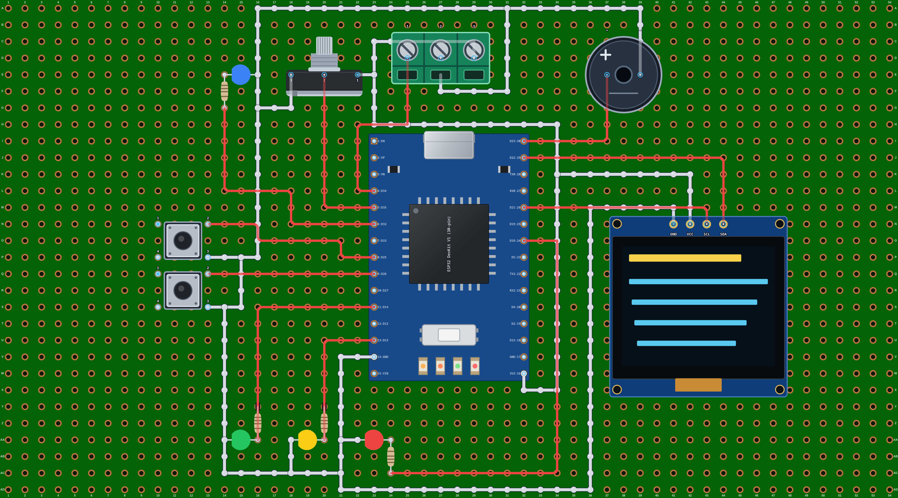

# Metrônomo Inteligente — ESP32 DevKit V1

> **Projeto Integrado de Computação (PIC) — Universidade Federal do Espírito Santo (UFES)**  
> **Integrantes:** Arthur Viana, Lorenzo Tottola e Maurício Gomez  
> **Vídeo de Demonstração:** [Assistir no YouTube](https://youtu.be/tWAc41eQ7TA?si=hNR8vgmL9nuaAOXz)

---

## Resumo do Projeto

O **Metrônomo Inteligente** é um dispositivo embarcado desenvolvido com **ESP32 DevKit V1** voltado para o treino de precisão rítmica de músicos. Além de operar como um metrônomo tradicional ajustável entre **30 e 180 BPM** (com feedback sonoro via buzzer passivo, visual via LED e painel em display OLED), o sistema conta com um **Modo Jogo**, no qual capta os ataques de um instrumento ou percussão por meio de um microfone **MAX4466**, calibra automaticamente o ruído do ambiente e calcula em tempo real a **acurácia rítmica (%)** do músico por compasso de 4 batidas.

---

## Descrição Completa do Projeto

### Arquitetura e Modos de Operação

Todo o firmware em [`code.ino`](code.ino) foi implementado de forma **não-bloqueante** (baseada em `millis()`), garantindo resposta simultânea dos botões, leitura contínua do potenciômetro, amostragem rápida do microfone e atualização sob demanda do display OLED SSD1306.

1. **Ajuste de BPM em Tempo Real (`30` a `180 BPM`)**
   - Um potenciômetro de `10 kΩ` conectado ao ADC de 12 bits (`GPIO 35`) define o andamento alvo.
   - Para evitar oscilações causadas por ruído natural do conversor analógico-digital, o código aplica um **filtro passa-baixas exponencial (EMA)** (`(potFiltrado * 7 + leitura) / 8`) aliado a um filtro de **confirmação por histerese** (4 leituras consistentes consecutivas antes de atualizar o BPM).

2. **Modo 1 — Metrônomo Tradicional**
   - Gera pulsos periódicos no intervalo exato de `60000 / BPM` ms.
   - Em cada batida, aciona simultaneamente o **buzzer passivo** em `1000 Hz` e o **LED azul** por `80 ms`.
   - O display OLED exibe o modo ativo e o valor do BPM em destaque.

3. **Modo 2 — Jogo de Detecção e Acurácia Rítmica**
   - **Etapa 1 — Calibração Automática do Ambiente (`10 s`):**  
     Ao entrar no Modo 2 (ou retomar pelo botão Start/Stop), o sistema realiza uma contagem regressiva de 10 segundos sem ataques sonoros e calcula, em passagem única pelo **Algoritmo de Welford**, a média DC (`centroMic`) e o desvio padrão (`desvioAmbiente`) do sinal do microfone MAX4466, além do maior pico de ruído (desconsiderando o 1º segundo para evitar o ruído mecânico do clique do botão). O limiar final de ataque é definido como:
     $$\text{limiar} = \max\big(7 \times \sigma_{\text{ambiente}},\; 1{,}40 \times \text{pico}_{\text{ambiente}},\; 100\big)$$
   - **Etapa 2 — Detecção de Ataques com Histerese:**  
     O detector acompanha lentamente o nível DC do microfone e identifica um ataque quando a amplitude ultrapassa `limiarAtaque`. Para evitar disparos múltiplos durante a ressonância de uma mesma nota/batida, exige que o sinal caia abaixo de `45%` do limiar para rearmar e respeita um **tempo morto de `120 ms`** entre ataques. Cada ataque detectado pisca o **LED azul**.
   - **Etapa 3 — Cálculo de Acurácia e Feedback por LEDs:**  
     A cada grupo de **4 ataques** (3 intervalos consecutivos), o sistema compara os intervalos reais com o intervalo esperado (`60000.0 / BPM`), calcula a acurácia média percentual (`0%` a `100%`) e exibe o resultado no OLED e nos LEDs indicadores:
     - 🟢 **LED Verde (`D14`):** Acurácia **acima de `90%`**
     - 🟡 **LED Amarelo (`D13`):** Acurácia entre **`75%` e `90%`**
     - 🔴 **LED Vermelho (`D18`):** Acurácia **abaixo de `75%`**

4. **Controles e Easter Egg ("Für Elise")**
   - **Botão Start/Stop (`D25`):** Pausa/retoma o funcionamento do sistema (com debounce por software de `30 ms`).
   - **Botão Modo (`D26`):** Alterna entre o **Modo 1 (Metrônomo)** e o **Modo 2 (Jogo)**.
   - **Easter Egg (Beethoven):** Pressionar o botão **Modo** **5 vezes em menos de 3 segundos** interrompe o fluxo atual, apaga os LEDs e executa a melodia *Für Elise* de Beethoven em loop no buzzer passivo com aviso no OLED. Pressionar **Modo** novamente encerra a música e retorna ao sistema.

---

## Histórico de Desenvolvimento e Evolução do Projeto

O projeto seguiu um ciclo completo de engenharia incremental — desde a concepção teórica até a confecção física em placa perfurada soldada em dupla face:

```
Planejamento Inicial ──▶ Simulação no Wokwi ──▶ Prototipagem em Protoboard ──▶ Layout Perfboard Designer ──▶ Soldagem & Polimento
```

1. **Planejamento Inicial ([`Planejamento-inicial/`](Planejamento-inicial/))**
   - Definição do escopo, cronograma dividido em épicos/quinzenas e especificação de componentes em [`planejamento.md`](Planejamento-inicial/planejamento.md) e [`apresentacao pic.pdf`](Planejamento-inicial/apresentacao%20pic.pdf).
   - Elaboração do esquemático conceitual inicial ([`esquemátic_pic.png`](Planejamento-inicial/esquem%C3%A1tic_pic.png)) originalmente pensado em Arduino Uno R3 com LED RGB e botões com pull-up externo.

2. **Simulação Funcional no Wokwi ([`wokwi-metronomo-inicial/`](wokwi-metronomo-inicial/))**
   - Migração da arquitetura para o **ESP32** visando maior capacidade de processamento, ADC de 12 bits e facilidade para expansão futura.
   - Validação virtual completa do hardware (potenciômetro, OLED I2C, botões, LEDs, buzzer e microfone simulado) com [`diagram.json`](wokwi-metronomo-inicial/diagram.json) e [`sketch.ino`](wokwi-metronomo-inicial/sketch.ino).

3. **Aplicação e Validação Incremental na Protoboard**
   - Montagem física por módulos independentes para eliminar erros de hardware passo a passo:
     1. Teste de BPM com potenciômetro + buzzer passivo (`1-BPM-Test`).
     2. Integração de botões com `INPUT_PULLUP` interno e LED de pulso (`2-Buttons+LED`).
     3. Soldagem dos pinos do display OLED SSD1306 no laboratório **ERUS** e validação do barramento I2C (`3-OLED`).
     4. Integração e calibração do módulo microfone **MAX4466** alimentado em `3,3 V` (`04-MAX4466`).
     5. Substituição do LED RGB único por **LEDs discretos** (Verde, Amarelo, Vermelho e Azul) com ajuste de resistores limitadores para operação em `3,3 V` (`05-LEDS`).

4. **Desenho da Soldagem em Placa Dupla Face no Perfboard Designer**
   - Transposição do circuito validado na protoboard para uma placa perfurada definitiva no software **Perfboard Designer**, resultando no diagrama de trilhas [`Esquematico.png`](Esquematico.png).
   - Planejamento cuidadoso de trilhas nas faces superior e inferior, posicionamento de bornes/conectores (para o microfone externo), barras de `GND` e `3,3 V`, evitando cruzamentos e curtos-circuitos.

5. **Soldagem, Depuração e Polimento (`06-EasterEgg`)**
   - Soldagem ponto a ponto dos componentes, inspeção e correção de pontos de solda (como validação do circuito do LED azul em `D32`), ajuste fino das faixas de acurácia (`>90%`, `75%–90%`, `<75%`) e inclusão do *Easter Egg* de Beethoven no código final [`code.ino`](code.ino).

---

## Esquemáticos dos Circuitos

### 1. Layout Final em Placa Perfurada Dupla Face (Perfboard Designer)



### 2. Esquemático Conceitual Inicial (Planejamento)


### Tabela de Pinagem Final (ESP32 DevKit V1)

| Componente | Pino no Componente | Pino ESP32 | Observação |
| :--- | :---: | :---: | :--- |
| **Potenciômetro (`10 kΩ`)** | Cursor (meio) | `D35` (`GPIO 35`) | Extremidades em `3V3` e `GND` |
| **Microfone MAX4466** | `OUT` | `D34` (`GPIO 34`) | Alimentação em **`3V3`** e `GND` |
| **Display OLED SSD1306** | `SDA` | `D22` (`GPIO 22`) | Endereço I2C `0x3C` (`Wire.begin(22, 21)`) |
| **Display OLED SSD1306** | `SCL` | `D21` (`GPIO 21`) | Alimentação em `3V3` e `GND` |
| **Buzzer Passivo** | `+` (Sinal) | `D23` (`GPIO 23`) | Acionamento via `tone()`, outro terminal no `GND` |
| **Botão Start / Stop** | Terminal 1 | `D25` (`GPIO 25`) | `INPUT_PULLUP` interno; outro terminal no `GND` |
| **Botão Modo** | Terminal 1 | `D26` (`GPIO 26`) | `INPUT_PULLUP` interno; outro terminal no `GND` |
| **LED Azul (Pulso)** | Ânodo (`+`) | `D32` (`GPIO 32`) | Com resistor limitador em série até o `GND` |
| **LED Verde (`> 90%`)** | Ânodo (`+`) | `D14` (`GPIO 14`) | Com resistor limitador em série até o `GND` |
| **LED Amarelo (`75%–90%`)** | Ânodo (`+`) | `D13` (`GPIO 13`) | Com resistor limitador em série até o `GND` |
| **LED Vermelho (`< 75%`)** | Ânodo (`+`) | `D18` (`GPIO 18`) | Com resistor limitador em série até o `GND` |

> **Nota sobre o barramento I2C:** Como o roteamento físico na placa dupla face conectou `SDA` ao pino `D22` e `SCL` ao pino `D21`, o firmware inicializa explicitamente `Wire.begin(PIN_SDA, PIN_SCL)` (`Wire.begin(22, 21)`).

---

## Dependências e Materiais Necessários

### Software e Bibliotecas (Arduino IDE)

1. **Arduino IDE** (versão `2.x` recomendada) ou PlatformIO.
2. **Pacote de Placas ESP32:** `esp32` by *Espressif Systems* (via Gerenciador de Placas), selecionando a placa **`DOIT ESP32 DEVKIT V1`**.
3. **Bibliotecas** (instalar via Gerenciador de Bibliotecas da Arduino IDE, também listadas em [`wokwi-metronomo-inicial/libraries.txt`](wokwi-metronomo-inicial/libraries.txt)):
   - **`Adafruit GFX Library`** (por Adafruit)
   - **`Adafruit SSD1306`** (por Adafruit)
4. **Bibliotecas nativas já inclusas no core ESP32:**
   - `Wire.h` (comunicação I2C)
   - `math.h` (cálculo de desvio padrão `sqrt` e módulo `fabs`)

### Hardware (Lista de Componentes)

- 1× **ESP32 DevKit V1 (30 pinos)**
- 1× **Módulo Microfone Eletreto com Amplificador MAX4466** (ganho ajustável via trimpot)
- 1× **Display OLED I2C 0,96" SSD1306 (128×64)**
- 1× **Potenciômetro linear `10 kΩ`**
- 1× **Buzzer passivo**
- 2× **Pushbuttons (chaves tácteis)**
- 4× **LEDs (Azul, Verde, Amarelo e Vermelho)**
- 4× **Resistores limitadores de corrente** para os LEDs (`100 Ω` a `330 Ω`, adequados para saída de `3,3 V`)
- Placa perfurada dupla face, borne KRE de 3 vias (para módulo/conexões) e fios/solda.

---

## Como Compilar e Executar

1. Clone ou baixe este repositório e abra o arquivo [`code.ino`](code.ino) na **Arduino IDE**.
2. Instale as bibliotecas **Adafruit GFX Library** e **Adafruit SSD1306**.
3. Em **Ferramentas → Placa**, selecione **`DOIT ESP32 DEVKIT V1`** e escolha a porta serial correspondente.
4. Faça o **Upload** do código para o ESP32.
5. *(Opcional)* Abra o **Monitor Serial** em **`115200 baud`** para acompanhar logs de BPM, estatísticas da calibração (`Desvio`, `Maior pico`, `Limiar`), força de cada ataque detectado e acurácia percentual.

### Guia Rápido de Uso

- **Ajustar BPM:** Gire o potenciômetro entre `30` e `180 BPM`.
- **Pausar/Retomar:** Pressione o botão **Start/Stop (`D25`)**.
- **Trocar de Modo:** Pressione o botão **Modo (`D26`)**:
  - No **Modo 1**, o buzzer e o LED azul marcam o tempo.
  - No **Modo 2**, aguarde **10 segundos em silêncio** para a calibração automática do ambiente; em seguida, execute **4 ataques** (palmas, baquetas ou instrumento) no andamento escolhido para receber sua nota de acurácia no OLED e nos LEDs.
- **Easter Egg:** Pressione o botão **Modo (`D26`) 5 vezes seguidas em menos de 3 segundos** para tocar *Für Elise*; pressione mais 1 vez para sair.

---

## Estrutura desta Pasta

```text
.
├── code.ino                       # Código-fonte final comentado para ESP32
├── Esquematico.png                # Diagrama da placa dupla face (Perfboard Designer)
├── README.md                      # Documentação completa do projeto
├── youtube.txt                    # Link do vídeo de demonstração no YouTube
├── Planejamento-inicial/          # Documentação, apresentação e esquemático inicial
│   ├── apresentacao pic.pdf
│   ├── esquemátic_pic.png
│   └── planejamento.md
└── wokwi-metronomo-inicial/       # Simulação inicial validada no Wokwi
    ├── diagram.json
    ├── libraries.txt
    ├── README.md
    └── sketch.ino
```
